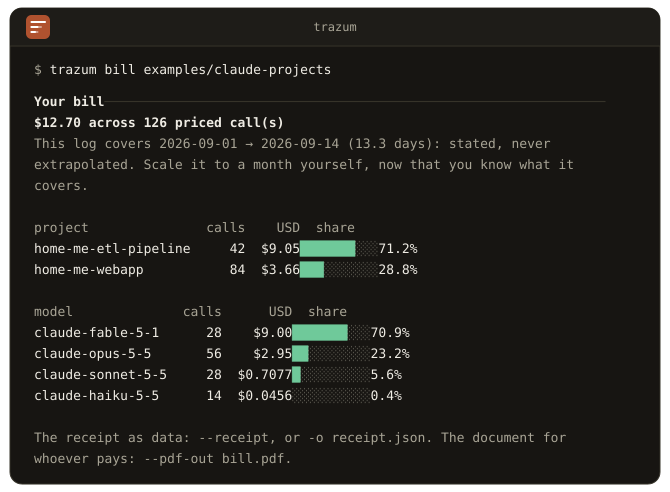
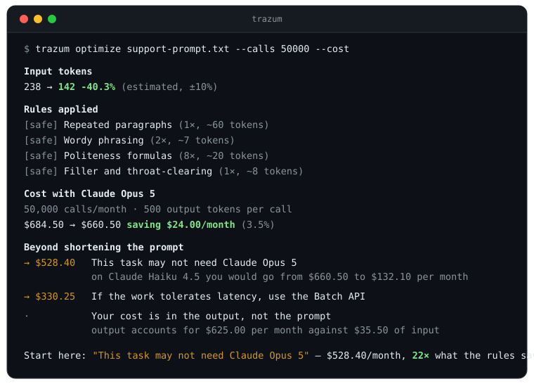
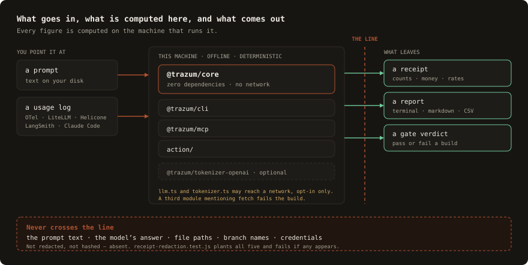

<div align="center">

# Trazum

### Understand your AI spend. Decide what to change.

Find where your AI usage costs money, choose a change, and check the result.
Trazum analyses local usage logs and prompts, ranks opportunities such as caching
and model changes, and keeps estimates separate from measured outcomes.

**Open source · Local analysis · No provider key needed to get started**

[](https://github.com/Davmunrey/Trazum/actions/workflows/ci.yml)
[](https://github.com/Davmunrey/Trazum/actions/workflows/security.yml)
[](LICENSE)
[](package.json)
[](#layout)

</div>

## Start here: one command, no global install

Requires Node.js 20 or newer. `npx` may download Trazum from npm.

```bash
npx @trazum/cli bill
```

<div align="center">



*Illustrative data from [`examples/claude-projects`](examples/claude-projects),
not a customer result. Generated from the CLI output.*

</div>

With no path, `bill` reads local Claude Code transcripts and groups the result
by project and model. **On a subscription, this is API-equivalent cost, not
what you paid.** Unpriced models are reported as gaps. Local analysis does
not upload your files.

Have a supported usage export instead? Pass its path:

```bash
npx @trazum/cli bill ./usage-export.jsonl
```

[Supported inputs](docs/usage-logs.md) ·
[Try sample data in your browser](https://trazum.vercel.app/?tab=playground)

## Turn a report into a decision

For teams paying for API usage, the useful question is what to change next.
Start with your largest workload, review the assumptions behind one finding,
and evaluate quality before changing models or prompts.

1. **Understand usage:** `bill` shows the recorded cost and coverage gaps.
2. **Choose one change:** `plan` ranks opportunities from a normalized usage log.
3. **Check the outcome:** `verify` compares the saved plan with later usage,
   including cases where the evidence cannot settle the result.

[Follow the first-report-to-verification walkthrough](docs/quick-start.md).
A projected saving is not a guaranteed reduction in your invoice.

## Using a subscription?

A smaller API-equivalent estimate does not reduce a fixed subscription fee.
Use Trazum to inspect conversation growth, review redundant prompt text and
set token budgets for instructions you control. Check task quality before
keeping a shorter prompt. This does not automatically manage your agent's
context or guarantee more messages under your provider's limits.

[Subscription efficiency workflow](docs/quick-start.md#subscription-efficiency).

## Keep or share a report

```bash
npx @trazum/cli bill ./usage-export.jsonl --html-out bill.html
```

PDF, CSV and Markdown exports are also available. Review the report before
sharing it: it contains usage and cost information.

## Pick your integration

Claude Code is the first native integration, not a provider lock-in. Codex
session imports, normalized usage logs and provider exports feed the same core.
MCP clients can query Trazum without having a native transcript adapter.

| You need | Start here |
|---|---|
| A terminal report | [Quick start](docs/quick-start.md) |
| Native agent session import | [Claude Code](docs/commands.md#the-agents-own-bill-trazum-from-claude-code) or [Codex](docs/codex.md) |
| An agent integration | [CLI, MCP and skill workflows](docs/agents.md) |
| An API contract or enforced call path | [Local HTTP API](docs/api.md) or [gateway](docs/gateway.md) |
| The full documentation | [Task-based index](docs/README.md) |

Harness, model and payment mode are separate facts. An API-equivalent estimate
is not a subscription invoice; a model without a price remains a gap.

<details>
<summary>Explore advanced workflows, commands, architecture and limitations</summary>

## Your agents spend money in a loop. This prices the call before it happens.

One agent costs what it costs. A fleet of them spends in a loop nobody is
watching per iteration, and the bill arrives a month later as one number with
no per-decision detail inside it.

Trazum installs into that loop. The MCP server's first tool is `spend_guard`,
and it is the only one here whose trigger is not a sentence somebody types:

```
"May I spend this?"  ->  yes, no, or cannot-tell.
```

A refusal carries the cheaper ways to make the same call, each priced for that
call and each naming what it assumes. The ceilings come from your
`trazum.config.json`; the spend so far comes from the usage log your host
already writes. Nothing is called and nothing is spent to answer.

```bash
claude plugin marketplace add Davmunrey/Trazum
claude plugin install trazum@trazum
```

That one line brings the skill and the MCP server. An agent that reads Agent
Skills from the repository instead gets the same skill with
`npx skills add Davmunrey/Trazum`. Every other MCP client
reads the same `mcpServers` JSON, so Cursor (`.cursor/mcp.json`), Windsurf,
Claude Desktop and the rest are one paste:

```json
{ "mcpServers": { "trazum": { "command": "npx", "args": ["-y", "@trazum/mcp"] } } }
```

The server is listed on the [official MCP registry](https://registry.modelcontextprotocol.io/v0/servers?search=io.github.Davmunrey/trazum)
as `io.github.Davmunrey/trazum`, and every release updates the listing.

**[Or run it right now, without installing anything: the Playground](https://trazum.vercel.app/?tab=playground)**

That link opens the CLI's pure subset running in the page, against sample files
already loaded, through the same `@trazum/core` functions the terminal runs.
Nothing you paste leaves your browser.

## The argument, in one screenshot

<div align="center">



*Real output, transcribed. Read the last two lines: the rules recovered $24.00
a month, and the advisory above them is worth $528.40, **22 times more**. That
gap is the entire argument for this tool.*

</div>

<div align="center">



*Generated by `npm run draw:architecture`, not drawn. `architecture-image.test.js`
fails the build if a package exists that the picture does not show, if the core
takes a dependency while the picture says it has none, or if a third module is
allowed to reach a network without the picture saying so.*

</div>

**The prompt is the part everyone looks at, and usually the cheap part.** In the
run above, forty percent of the text came out and it moved 3.5% of the bill.
What moved the rest was a question nobody was asking: does this task need the
model it is running on?

**Every figure has a receipt.** Sixteen advisories, each priced per month and
reproducible on a single file: caching you are not getting, work that could go
through the Batch API, a schema costing tokens on every call to describe a shape
the request could carry as a parameter. Underneath them, twelve deterministic
rules that shorten the text itself: same input, same output, free, offline, and
never touching code, URLs, email addresses or placeholders. On top, an **optional LLM pass** for
the compression rules cannot do, through whichever provider you configure, which
never runs unless you ask.

```
                      ┌──────────────┐
                      │ @trazum/core │   the library: rules, tokens, pricing
                      └──────┬───────┘   zero dependencies, browser-safe
    ┌────────────┬─────────────┼─────────────┬─────────────┐
 @trazum/cli  @trazum/mcp  trazum-vscode  @trazum/web    action/
 52 commands   MCP server    the editor      Next.js    comments on
              for your agents  status bar               pull requests

              @trazum/tokenizer-openai   optional: exact counts for OpenAI
                    install it or do not, nothing else changes
```

## Contents

| I want to… | Go to |
|---|---|
| Get a first result | [Quick start](docs/quick-start.md) |
| Understand recorded spend | [Usage inputs](docs/usage-logs.md) and [bill/profile](docs/commands.md#find-a-command) |
| Set budgets | [CI gates](docs/ci.md) or [gateway decisions](docs/gateway.md) |
| Integrate Trazum | [CLI, web, library and agents](docs/setup.md) |
| Find a command or a data contract | [Command reference](docs/commands.md) and [documentation index](docs/README.md) |

[Limitations](#limitations-stated-plainly) · [Privacy](#analytics-and-privacy) ·
[Pricing](#every-model-you-pay-for-by-the-token) · [Contributing](CONTRIBUTING.md)

## What it actually does

The analyser reports sixteen findings, with assumptions attached to each estimate.

**1. Tells you where the money actually is.** This is the part worth reading
first, because it is where the numbers are. Every advisory is priced per month
against your own call volume, and none of them is about making the text shorter:

| Advisory | Why it matters |
|---|---|
| Prompt caching | Reading from cache costs 10% of input. The saving is computed over the **real stable prefix**: in a template with `{{placeholders}}`, only what precedes the first one is cached — not the whole prompt. |
| Reorder the template | Stable instructions sitting *after* the first variable placeholder never cache today. Trazum prices moving them in front — and with `--reorder`, [does it](docs/commands.md#reordering-for-the-cache---reorder). |
| Batch API | 50% off input and output when the work tolerates latency. |
| Cheaper model | Complexity heuristic: if the task looks simple, what dropping a tier would save. |
| Output-dominated cost | If you pay more for the answer than for the prompt, shortening the prompt has a ceiling. |
| Promotional pricing | Warns when you are budgeting with an introductory price that expires. |
| Context window | If the prompt does not fit, the call is going to fail. |
| Contradictory instructions | "Answer in English" three paragraphs above "reply in the customer's own language". The model has to pick one, and which one can change between calls — a correctness problem that also costs tokens twice. |
| Redundant examples | Few-shot examples that are near-copies of an earlier one, and what they cost per month. |
| Output format stated twice | A schema shown in a code block and then walked again in prose. The block is the version worth keeping. |
| Schema the request could carry | A schema block introduced by "Output format:" is paid for in input tokens on every call. Every major API now takes a response schema as a *parameter* — supported structured-output APIs can enforce the shape, but schema tokens may still be billed. See below. |

The last four are **advisory only**. A contradiction has a right answer that only
the author knows, and an example that looks redundant may be demonstrating a
boundary case on purpose. Trazum points; it does not cut.

#### Structured output is a code change

Trazum can identify an output schema described inside a prompt and suggest
using the provider's structured-output API instead. It never removes that
schema automatically: the calling application must preserve the contract.

A constrained decoder can improve format reliability where supported.
**Moving a schema to a request parameter does not prove a billing saving:**
providers may still count schema tokens. Compare actual usage before claiming
savings. The finding estimates the prompt text involved, not a guaranteed
reduction in the provider's bill.

Only blocks preceded by an explicit output cue are considered. Example input
is data the model may need and must not be removed as though it were a schema.

The example detector finds near-copies — the way few-shot blocks actually grow.
It deliberately does not flag *paraphrases*: that case needs a model, and is on
the roadmap for the LLM pass.

**2. Then it trims the prompt itself.** Twelve deterministic rules: courtesy,
filler, verbose phrasing, duplicated paragraphs, decorative separators, shouting
in capitals. Two levels — `safe` (no semantic risk) and `aggressive` (read the
diff). This is the smallest number on the page more often than not, and it is
reported that way rather than dressed up.

**3. And never touches what would break the prompt.** Code fences, indented code
blocks, inline code, URLs, email addresses, template placeholders (`{{x}}`,
`${x}`, `{x}`, ``) and XML/HTML tags are isolated before any rule runs. If a rule ever did make one of those
disappear, that rule is discarded and the rest carry on.

**Reviewing an aggressive run.** Every rule reports what it actually changed,
so the level that saves the most is judged rule by rule rather than as one wall
of diff — and a single rule you disagree with comes off with `--disable`:

```
  [aggressive] Intensifiers (3×, ~6 tokens)
      VERY → —
      extremely → —
      quite → —
  [aggressive] Self-verification instructions (1×, ~17 tokens)
      You should double-check your answer before re… → —
```

**4. Optionally, runs it past an LLM.** The result is only accepted if it is
shorter and leaves protected content byte-identical. Otherwise the deterministic
version stands. It never returns something worse than where it started. With
`--suggest` it proposes phrases one at a time — `You should always make sure to →
Always` — each checked against your prompt before you see it, so eight surviving
out of ten is a useful morning rather than a rewrite to read end to end.

**5. Answers the questions that come before "shorten this".** Trimming one file
is the smallest thing here. `optimize` is one of 52 commands — [the table
above](#the-52-commands) names what each answers — because knowing a prompt
is wasteful is not the same as knowing *which* prompt, *whose* change made it so,
or whether the shorter version still works.

`check`, `diff`, `rank` and `blame` all take `--markdown-out`, so the answer can
land in a pull request comment rather than a terminal nobody is looking at.

**It gates in whatever CI you already run.** One binary, two exit codes, and
[worked recipes for GitLab CI, Jenkins, CircleCI and a pre-commit hook](docs/ci.md)
— no vendor plugin, because each one would be a second code path that drifts
from the exit codes it is supposed to relay.

---

<a id="the-51-commands"></a>

## The 52 commands

| Command | What it answers |
|---|---|
| [`trazum init`](#the-first-five-minutes-trazum-init) | Inspect repository prompts and available usage, then write a configuration. *Optional setup after your first report.* |
| [`trazum optimize`](#cli) | What can come out of this prompt, and what is that worth a month? |
| [`trazum check`](#cli) | Does this prompt fit its token budget, and has the repository drifted past its recorded baseline? *Exits 1 when either fails — this is the CI gate.* |
| [`trazum baseline`](docs/commands.md#the-ci-gate-a-budget-is-a-ceiling-a-baseline-is-a-gate) | What does this repository's prompts cost right now? *Records it, to commit.* |
| [`trazum diff`](docs/commands.md#did-this-edit-make-it-worse) | What did this edit cost? |
| [`trazum rank`](docs/commands.md#which-prompt-to-fix-first-trazum-rank) | Of these forty prompts, which is worth an afternoon? |
| [`trazum doctor`](docs/commands.md#the-whole-workspace-at-once-trazum-doctor) | What is wrong across the whole workspace? |
| [`trazum prune`](docs/commands.md#which-few-shot-examples-earn-their-tokens-trazum-prune) | Which few-shot examples earn their tokens? Measured, and it asks before spending. |
| [`trazum blame`](docs/commands.md#who-made-this-prompt-expensive-trazum-blame) | Who made this prompt expensive, and when? |
| [`trazum eval`](docs/commands.md#does-the-shorter-prompt-still-work) | Does the shorter prompt still do the job? |
| [`trazum where`](docs/commands.md#prompts-where-they-actually-live) | Which prompts are hiding inside my source files? |
| [`trazum models`](#every-model-you-pay-for-by-the-token) | What does each model cost, and what is its cache minimum? |
| [`trazum profile`](#where-the-money-actually-went-trazum-profile) | Where did the money actually go? *Reads a usage log, not a prompt.* |
| [`trazum route`](docs/commands.md#is-the-cheaper-model-good-enough-trazum-route) | Is the cheaper model good enough? *Measured, and it asks before spending.* |
| [`trazum plan`](docs/commands.md#the-plan-trazum-plan) | Of everything the log shows, what do I do first, and what is each move worth? |
| [`trazum verify`](docs/commands.md#did-it-work-trazum-verify) | Did the plan's savings actually arrive? *Three outcomes, never two.* |
| [`trazum history`](docs/commands.md#the-long-run-trazum-history) | What have twenty reports been saying that no two of them could? *Shapes, never forecasts.* |
| [`trazum connect`](docs/commands.md#your-bill-without-the-export-trazum-connect) | What did the provider actually bill me? *Read from their API, nothing exported by hand.* |
| [`trazum store`](docs/commands.md#keeping-it-trazum-store) | What have I measured and kept? *Aggregates only — no prompt text, ever.* |
| [`trazum watch`](docs/commands.md#the-afternoon-it-happened-trazum-watch) | Has anything crossed a budget? *Measured crossings only — never a forecast.* |
| [`trazum serve`](docs/commands.md#before-the-call-is-sent-trazum-serve) | What will this call cost, and is there budget? *Answered in milliseconds, halves kept apart.* |
| [`trazum gateway`](docs/commands.md#in-the-path-of-the-call-trazum-gateway) | Can it stop the call instead of advising against it? *Refuses; never substitutes.* |
| [`trazum ladder`](docs/commands.md#is-the-ladder-saving-money-or-is-it-a-bill-trazum-ladder) | Is cheap-first-escalate-on-failure saving money, or costing it? *Break-even rate, stated.* |
| [`trazum experiment`](docs/commands.md#two-arms-on-real-traffic-trazum-experiment) | Which of two arms is better on real traffic? *A winner only when there is one.* |
| [`trazum quality`](docs/commands.md#the-gate-that-fails-a-build-for-quality-trazum-quality) | Did that prompt change quietly make the product worse? *Refuses to blame what it cannot attribute.* |
| [`trazum semantic`](docs/commands.md#the-findings-a-dictionary-cannot-see-trazum-semantic) | Does this prompt say the same thing twice, or contradict itself? *The model proposes; the checker disposes.* |
| [`trazum owners`](docs/commands.md#whose-money-trazum-owners) | Whose budget does this land on? *The unallocated is never spread.* |
| [`trazum commitment`](docs/commands.md#should-you-sign-that-commitment-trazum-commitment) | What would that committed-use deal have been worth? *On measured months, both directions priced.* |
| [`trazum report`](docs/commands.md#the-year-from-what-was-already-written-down-trazum-report) | What did the year actually look like? *No new data, and it lists its own blind spots.* |
| [`trazum schema`](docs/commands.md#building-on-the-format-trazum-conform) | Which fields must a document of this format carry? *A JSON Schema, for validators that are not Trazum.* |
| [`trazum conform`](docs/commands.md#building-on-the-format-trazum-conform) | Does the document my tool emits conform, and what will it not be able to answer? |
| [`trazum rollup`](docs/commands.md#more-than-one-machine-trazum-rollup) | Four of us measured four things — what is the total, and what did merging lose? *A format and a merge, not a service.* |
| [`trazum pulse`](docs/commands.md#did-anything-stop-running-trazum-pulse) | Did the things that are supposed to run, run? *Runs nothing itself — your CI is the thing that notices.* |
| [`trazum position`](docs/commands.md#where-the-month-stands-trazum-position) | Where does the month stand against every ceiling? *Measured, denominators attached, no forecast anywhere.* |
| [`trazum receipt`](docs/commands.md#a-figure-that-still-answers-elsewhere-trazum-receipt) | What did this cost, in a form that still answers when read somewhere else? *Counts, and the money split so it can be added up rather than believed. No prompt text, no answers, no paths: there is no field for them.* |
| [`trazum from-claude-code`](docs/commands.md#the-agents-own-bill-trazum-from-claude-code) | What did my Claude Code sessions cost? *Reads the transcripts already on disk — the numbers only, never the words.* |
| [`trazum from-codex`](docs/codex.md) | What API-equivalent usage can a local Codex rollout support? *Explicit paths, corroborated counters, no prompt content.* |
| [`trazum from-otel`](docs/commands.md#the-universal-cost-lens-trazum-from-otel) | What did the LLM calls in my OpenTelemetry export cost? *Reads the GenAI spans any exporter already emits — the counts only, never the prompts.* |
| [`trazum from-litellm`](docs/commands.md#the-gateway-everybody-already-runs-trazum-from-litellm) | What did the calls my LiteLLM proxy logged cost? *Reads the spend log the gateway already writes — the counts only, never the prompts, keys or addresses on the same row.* |
| [`trazum reconcile`](docs/commands.md#what-you-were-actually-billed-trazum-reconcile) | Does what Trazum computed match what the provider charged? *Sets the two figures beside each other, never merges them, and leaves the unexplained remainder standing on its own.* |
| [`trazum bill`](docs/commands.md#one-door-trazum-bill) | What did all of this cost? *One door: reads a file or a directory of anything the converters read, tells each file's shape from its own text, converts, prices, and ends on the receipt. A file no shape claims is named, never guessed.* |
| [`trazum from-openrouter`](docs/commands.md#what-the-router-says-trazum-from-openrouter) | What does OpenRouter say I used? *Reads the activity report your own management key fetched, keyed by the same slugs the live pricing overlay uses; what OpenRouter charged is printed beside Trazum's figure and never merged, and reasoning tokens are counted, not added.* |
| [`trazum from-openai`](docs/commands.md#what-openai-says-trazum-from-openai) | What does OpenAI say my organisation used? *Reads the completions usage report your own admin key fetched; the record keeps OpenAI's own cached-inside-prompt shape, batch rows and non-default tiers are left out and named, and audio or image tokens are never priced at a text rate.* |
| [`trazum from-anthropic`](docs/commands.md#what-the-provider-itself-says-trazum-from-anthropic) | What does the provider itself say my organisation used? *Reads the usage report your own admin key fetched; Trazum never holds the credential, refuses to price a batch row at a standard rate, and labels by workspace only from a mapping you write.* |
| [`trazum from-helicone`](docs/commands.md#the-proxy-that-kept-every-request-trazum-from-helicone) | What did the requests my Helicone proxy kept cost? *Prices the model that answered, not the one that was asked for, and counts the substitutions.* |
| [`trazum from-langsmith`](docs/commands.md#the-tree-that-is-not-a-list-trazum-from-langsmith) | What did the model calls in my LangSmith traces cost? *Only the llm runs, because a trace is a tree and summing it bills the same tokens twice — and it refuses to price a call by the client class that made it.* |
| [`trazum switch`](docs/commands.md#when-does-the-switch-pay-trazum-switch) | Should we move this traffic, and when does moving pay? *Measured delta, declared migration cost, break-even as division on the past — and the required evaluation itself priced.* |
| [`trazum ownrate`](docs/commands.md#the-model-you-run-yourself-trazum-ownrate) | What does my self-hosted model cost per million tokens? *Your GPU rate over your measured throughput — derived from your declaration, never guessed.* |
| [`trazum bench`](docs/commands.md#this-machine-measured-trazum-bench) | How fast is Trazum here, and on what? *One shot per workload, no judgement — run it before and after a change.* |
| [`trazum write`](docs/commands.md#you-describe-it-it-asks-trazum-write) | What should this prompt say, and what will it cost before I ever send it? *Asks; nothing is generated.* |
| [`trazum rules`](#what-it-actually-does) | Which rules exist, and what does each one do? |
| [`trazum feedback`](docs/commands.md#telling-us-something-trazum-feedback) | Where do I report this, and what will you ask me for? *Sends nothing.* |

## Getting started

**Node.js 20 or newer.** `npx` can download the package; local analysis requires
no API key. Choose the task that matches the data you already have:

```bash
npx @trazum/cli bill ./usage-export.jsonl
npx @trazum/cli optimize ./prompt.txt --cost
```

The first reads recorded usage. The second estimates changes to a prompt;
its projected savings are not a provider invoice. See the
[quick start](docs/quick-start.md) for a reproducible example and next steps.

### The first five minutes: `trazum init`

After your first report, optionally run `npx @trazum/cli init` in your project
to inspect prompts and available usage, write a config and identify a finding. Read
[what init writes and refuses to overwrite](docs/setup.md#the-first-five-minutes-trazum-init).

### CLI

Install with `npm install -g @trazum/cli`, or keep using `npx`.
[CLI examples and configuration](docs/setup.md#cli) cover token budgets,
reports, CI and pricing overrides. [Command reference](docs/commands.md).

### The rest of the commands, in their own book

[Find a command by task](docs/commands.md#find-a-command).
`trazum --help` lists commands; `trazum <command> --help` explains its flags.

### Web

[Open the Playground](https://trazum.vercel.app/?tab=playground) to try sample
files. For local development, run `npm install`, `npm run build`, then
`npm run dev:web`. [Web setup and API recipes](docs/setup.md#web).

### Signing in (optional)

Accounts are disabled by default. Enabling them adds a saved prompt library
and share links backed by the deployment operator's database.
[Account setup and data handling](docs/accounts.md).

### Deploying to Vercel

[Deployment instructions](docs/setup.md#deploying-to-vercel),
[environment variables](.env.example), and [N0 deployment](docs/deploy-n0.md).

### Library

Install `@trazum/core` to use analysis in your application.
[Library examples](docs/setup.md#library) and [package API](packages/core/README.md).

## Languages

Reports are available in **English and Spanish** (`--locale es`, or the
browser's language on the web). A locale changes the report, never the
optimisation: same optimised text, same token counts, same advisory ids in
either language. The full story — what is translated, what is deliberately
not, and how the report and the prompt each pick their language — is in
[the command reference](docs/commands.md#languages).

## Connecting your own LLM

The optional LLM pass (`--suggest`, `eval`, `route`) speaks to whichever
OpenAI-compatible or native endpoint you configure by environment — vLLM,
Ollama, OpenRouter, Anthropic, Gemini, Bedrock and Vertex included, keys
never stored. Configuration, refusals and the `--pricing-live` overlay are
in [the command reference](docs/commands.md#connecting-your-own-llm).
## Every model you pay for by the token

Trazum prices Anthropic, OpenAI, Google, Moonshot, DeepSeek, xAI and Mistral:

**Every report says how old the prices are** — the date the table was checked and
how many days ago that was — because every dollar figure descends from that list,
and a date on its own makes you subtract against today to learn whether to trust
it. Past 45 days the report says so in a sentence, rather than leaving the reader
to decide what "old" means.

The 7 providers publish independently, so each carries its own review date and
`trazum models` prints them; the headline figure above is the oldest of the seven,
because the question "how old is this table" is about its worst part.

```bash
trazum optimize prompt.txt --model gpt-5 --calls 50000
trazum optimize prompt.txt --model kimi-k3
trazum models                      # the whole table, with each provider's terms
```

Everything that reads the prompt is provider-agnostic already — the rules, the
protection pass, `--reorder`, the contradiction and example detectors all operate
on text. What differs is the money, and **that is not one set of numbers**:

| | |
|---|---|
| Cache read | 10% of input on OpenAI (5% on GPT-6.1 Sol), Google, Mistral, Moonshot's Kimi K3 and Anthropic up to Opus 5 and Sonnet 5; **17% to 20%** on Moonshot's K2 series; **per model on xAI**, 15% on Grok 4.5, 16% on 4.3 and the 4.20 family, 20% on Build 0.1 and 25% on 4.6 and 4.7. Two providers changed it **between generations**: Anthropic's Opus 5.5 and Sonnet 5.5 read at **5%** and Fable 5.1 and Mythos 5.1 at **2.5%**, and DeepSeek V4.1 Flash reads at **2%** and V4 Pro at about **3%** where V3 read at 10% |
| Cache write | 125% of input on Anthropic and on OpenAI's GPT-5.6 and later, whose entry lives at least 30 minutes; Kimi K3 bills it **as its own line by TTL** like Anthropic, 100% for five minutes and 200% for an hour; 100% on earlier OpenAI models, Google, Kimi's K2 series, DeepSeek and xAI; Mistral publishes no write price and reports no write tokens |
| Cache minimum | **Per model, not per provider.** Anthropic alone spans 512 to 4,096; 1,024 on OpenAI and DeepSeek; 4,096 on Gemini 3.6 Flash, 3.8 Flash and 3.1 Pro and 2,048 on the retired Gemini 2.5 models; Moonshot, xAI and Mistral publish none, so their cache is priced from your log and the advice that needs a minimum stays quiet |
| How caching starts | You mark the prefix on Anthropic; it is **automatic** on OpenAI, Google, Moonshot, DeepSeek and xAI; Mistral does not say, so Trazum gives no caching advice for it |
| Batch API | 50% on Anthropic, OpenAI, Google and Mistral; 40% off on Kimi K2.7 Code and K2.6; 20% off on Grok 4.3 and the 4.20 family; **none at all** on DeepSeek, Kimi K3 and the rest of xAI |
| Not one price | Claude Haiku 5.5, Gemini 3.1 Pro Preview, OpenAI's GPT-5.6 and later and every current Grok charge **each request by its prompt length**, dearer over 100,000, 200,000 and 272,000 tokens, and on xAI from exactly 200,000; DeepSeek V4 charges **by the clock**, half price off-peak. A call is billed in its own band; a usage report's summed row is billed at the dearer rate with the cheaper figure printed beside it. `grok-4`, retired on 2026-05-15, has billed at Grok 4.3's prices since, and a log spanning the date is billed both ways |

**The cache minimum is the row to read twice, and it used to be wrong here.** This
table said *"512 on Anthropic"* flatly. Anthropic's floor is a property of the
model: 512 on Fable 5.1, Fable 5, Mythos 5.1, Mythos 5, Opus 5.5, Opus 5,
Sonnet 5.5 and Haiku 5.5; 1,024 on Opus 4.8, Sonnet 5 and Sonnet 4.6; 2,048 on Opus 4.7;
**4,096 on Opus 4.6, Opus 4.5 and Haiku 4.5**. A reader on
Haiku 4.5 who trusted "512" would have built a prefix eight times too short and been
told caching would save money that could never arrive — the one direction this
tool must never be wrong in. `trazum models` prints the real figure per model,
and every cache advisory has always used it; only this table was wrong.

Those last two rows are why the multipliers had to move onto the model. As global
constants they offered a batch discount to providers that do not sell one and a
caching saving to a model that has no cache — invented savings, which is the one
thing this tool must not print. A provider with no batch API now gets no batch
advisory, and no discount even if you tick the box: `batchEligible` describes the
work, not what the provider sells.

**A cheaper model means a cheaper model, not a different supplier.** The downgrade
advisory only ever suggests models from the provider you are already on. Dropping
a tier is a one-line change; switching vendor is a migration, and this advisory is
a keyword heuristic — it has no business recommending that you change supplier.

**Not covered: subscription invoices.** API token prices cannot establish how
much a subscription bill will change. Claude Code, Codex and Cursor identify
the tool, not its payment mode; Trazum defaults to token figures in those hosts.
An explicit `--cost` requests an API-price scenario, not guaranteed invoice savings.

### Optimising a prompt that lives in code

```bash
trazum optimize src/prompts.ts --prompt support --diff
```

It reads the marked prompt and leaves the file alone. **Pointed at an unmarked
source file it refuses**, because optimising TypeScript as if it were prose does
not produce a worse prompt — it produces broken code, and `-o` would write that
back over your file. When a file holds several marked prompts it asks which one
rather than taking the first.

The model comes from the code too, so a file calling OpenAI is priced against
OpenAI. `--model` and `trazum.config.json` still win: flags beat config, config
beats detection, detection beats a built-in default that has no idea which
provider you use.

### Which provider is this prompt even going to?

Since Trazum prices 7 providers, defaulting to Claude became a **wrong
number**: a file calling OpenAI was billed against Claude Opus 5 without comment.
`trazum where` reads what the code already says.

```bash
trazum where src/prompts.ts
```

```
Running inside
  Claude Code (CLAUDECODE)
  Claude Code identifies the execution host only. Payment mode is unknown;
  token prices do not establish invoice savings.

Prompts in src/prompts.ts go to
  anthropic · Claude Sonnet 5
    line 2  model-literal: claude-sonnet-5
    line 1  sdk-import: @anthropic-ai/sdk

Priced as
  Claude Sonnet 5 (read from the source)
```

**Every answer names the line it came from.** Four kinds of evidence, strongest
first: `model=` on a `trazum:prompt` marker, a quoted model id, a base URL, an
SDK import — and **a base URL beats the SDK it was pointed at**, because
Moonshot, DeepSeek, xAI and Groq are all called through the OpenAI SDK with a
different `base_url`. **It refuses when a file names two providers**: picking
silently is how somebody budgets against the wrong provider for a month.
Detection sits in the usual layering — a flag beats config, config beats
detection, detection beats the built-in default.

With no file it reports only the host. Environment variables identify the tool,
not whether a workload uses an API, a subscription, credits or a local model:

| Host | Payment mode inferred from environment |
|---|---|
| Claude Code, Codex, Cursor | unknown |
| GitHub Actions, CI | unknown |
| VS Code, plain terminal | unknown |

### Agent harnesses default to tokens, not invoice savings

Inside Claude Code, Codex or Cursor, Trazum conservatively defaults to token
figures. This is a display policy, not a claim about your payment arrangement.
Use `--cost` to request the API-price scenario; it is not a subscription invoice:

```
What this buys on Claude Code
  Claude Code identifies the tool, not your payment mode. Tokens are shown
  by default; invoice savings are unknown.

  1,001 tokens back, every call.
  Context window: 12.4% → 2.1% of Claude Opus 5's 1,000,000 tokens — room the
  conversation gets instead.
  Pass --cost if this prompt is bound for a metered API.
```

The context window is the real currency in an agent: every token the system
prompt holds is one the conversation cannot.

**Advisories whose only pitch is money are hidden in this view.** Whether they
reduce your invoice depends on your payment arrangement. `model-downgrade`, `batch-api`,
`output-dominated` and `promo-pricing` are dropped; caching, context overflow,
contradictions and redundant examples stay, because latency, headroom and
correctness are still real.

**The escape hatch matters.** The host says where *Trazum* runs, not where your
prompt goes — somebody editing a production prompt inside Cursor wants the
dollars, and `--cost` gives them back without leaving the editor. `--tokens-only`
forces the other direction anywhere.

## Where the money actually went: `trazum profile`

The command the rest of the product orbits: hand it a usage log (or a
directory of rotated ones) and it reads what the provider actually charged —
the spend split, whether caching paid for itself, conversation growth, the
answers cut off mid-generation, and the levers that would genuinely move
the bill, priced from your own calls. It reads counts, never content; a
session key groups and is never printed; a model it cannot price is named
and kept out of the totals rather than silently absorbed.

The full chapter — the record format, `--against`, `--what-if`, the cache
post-mortem, the conversation ceiling, every gate — is in
[the command reference](docs/commands.md#where-the-money-actually-went-trazum-profile).

## Where this fits, said at the front door

Every `optimize` run closes with the same sentence, because it is the truth about
what the command just did:

```
  Shortening a prompt is the smallest lever there is: measured on an ordinary
  support prompt, the rules recover about 1% of a monthly bill. On a metered
  API the things that move 60% to 80% are which model the call goes to, the
  Batch API, prompt caching, and what re-sending the conversation costs — and
  "trazum profile <usage.jsonl>" prices all four from what the provider
  actually charged.
```

A tool whose first command reports 1% and says nothing about the other 99% has
not told you what it knows.

## Token counting

A dependency-free estimator with a **band measured per kind of text** — ±4% on
CJK, ±6% on Latin prose, ±26% on code and markup, ±33% on tabular numbers —
measured over 47 samples in ten languages, where the worst error in each bucket
is 3.2%, 5.6%, 25.1% and 32.5%. Language-aware because one English divisor was
37% wrong on German. `--exact-tokens` settles any doubt
against the provider's free counting endpoint. The measurement story is in
[the command reference](docs/commands.md#token-counting).
---

## Limitations, stated plainly

- **Savings are projections, not billing.** They are computed over the scenario
  you describe (calls/month, output tokens) using the table in
  `packages/core/src/pricing.ts`. Check that table before budgeting:
  `PRICING_LAST_REVIEWED` tells you when it was last updated.
- **Output tokens are held constant in the calculation.** A shorter prompt
  often produces somewhat shorter answers, but that depends on the task and
  cannot be promised. The saving shown comes from input only.
- **The model recommendation is a keyword heuristic**, not a judgement about
  answer quality. Measure the difference with your own evaluations before
  dropping a tier in production.
- **The aggressive level can change nuance.** It removes intensifiers, hedges
  and self-verification requests. Read the diff before applying it.
- **Amazon Bedrock and Vertex AI pricing is set by each partner** and is not
  the pricing in this table.

---

## Layout

```
packages/core/     dependency-free library (rules, tokens, pricing, LLM)
  src/segment.ts     isolation of code, URLs, emails, templates and XML
  src/rules.ts       deterministic rules engine
  src/phrases.ts     phrase dictionaries (data, multilingual)
  src/pricing.ts     model and pricing catalogue
  src/structure.ts   contradictions and repeated few-shot examples
  src/similarity.ts  shared near-duplicate scoring
  src/advisories.ts  caching, batch, model and context advisories
  src/reorder.ts     moving blocks in front of the first placeholder
  src/compare.ts     comparePrompts — after minus before, positive is worse
  src/profile.ts     the measurements behind `rank`, and no score
  src/suggest.ts     phrase-level rewrites, and the checks each one passes
  src/promptfoo.ts   exporting a suite for somebody else's assertions
  src/extract.ts     prompts marked inside source files
  src/detect.ts      which provider a file actually calls
  src/llm.ts         pluggable providers and safety checks
  src/net.ts         endpoint validation, the allowlist, safe fetch defaults
  src/i18n/          message catalogues (report language)
  src/shared-prefix.ts  preambles that could share a cache entry and do not
  src/usage.ts       the usage-log profiler: where the money actually went
  src/levers.ts      what would move the bill, priced from tokens that were billed
  src/conversation.ts   what re-sending the conversation costs, a ceiling
  src/output-shape.ts   where the output spend concentrates: tail or task
  src/prune.ts       leave-one-out over few-shot examples, against the noise floor
  src/aws-sigv4.ts   Bedrock's signature, by hand, on WebCrypto
  src/gcp-auth.ts    Vertex's service-account JWT, same reasoning
  src/openrouter.ts  live prices, with the unknowns marked unknown
packages/cli/      dependency-free CLI
  src/markdown.ts    the report as markdown, and the three escapers
  src/git.ts         the only module here that runs another program
packages/mcp/      dependency-free MCP server — ten tools over stdio
  src/rpc.ts         JSON-RPC 2.0 by hand; the invariant beat the SDK
  src/tools.ts       the whole surface an agent can reach, in one file
packages/tokenizer-openai/   optional exact counter, and the only dependency here
  src/index.ts       OpenAI's own ranks; refuses a model it has no table for
apps/web/          Next.js (App Router) — Optimise, Compare, Your bill, Library
action/            the packaged GitHub Action that comments on pull requests
scripts/           release notes, the token-band harness, rollback recovery
  draw-architecture.mjs  redraws the picture above from the workspace globs
  build-wiki.mjs     rebuilds wiki/ from this file, verbatim, section by section
wiki/              the GitHub wiki, generated — every page is a section of a
                   document above, so there is nothing here to keep in sync
```

## Updating prices

`packages/core/src/pricing.ts` is the single source of truth, reviewed on a
stated date; overlays (`--pricing`) and the live OpenRouter feed
(`--pricing-live`) correct it without an upgrade. The recipe and its guards
are in [the command reference](docs/commands.md#updating-prices).
## Analytics and privacy

**There are two configurations and they have different answers.** Both are stated
here because the short version was wrong: this section said prompts are never
stored on any server, without qualification, for several releases after the
prompt library shipped and made that conditional.

- **Signed out — the default.** Nothing about a prompt is written server-side.
  Optimisation is synchronous: the response carries the result, and history lives
  in the browser's localStorage. This is what a deployment does with no
  `TRAZUM_GITHUB_CLIENT_ID` configured, and signing in cannot be switched on by a
  visitor.
- **Signed in, with the prompt library.** Saving a prompt writes its text to
  Postgres — `trazum_prompt_versions.text`, one row per version, because a library
  that cannot show you yesterday's wording is not a library. Nothing is written
  until you save, and the database is the operator's rather than ours.
  [docs/accounts.md](docs/accounts.md) is the full account, including the row
  level security the schema turns on and why it uses `ENABLE` and not `FORCE`.
- Analytics (PostHog) is **off by default** and never sends prompt content —
  only aggregate metrics (reduction percentage, level, model, locale). It
  switches on only when the operator sets `NEXT_PUBLIC_POSTHOG_KEY`, which also
  adds the analytics origin to the Content-Security-Policy; with no key the
  policy stays `connect-src 'self'`. When it is on, the only events sent are
  the ones the app names: autocapture, automatic pageviews, session
  recordings, heatmaps and surveys are switched off by name, nothing is kept
  in a cookie, and every URL an event carries has its share token replaced
  (`/c/:token`) and its query dropped before it leaves the browser.
- LLM keys entered in the UI are used for that request and discarded; they are
  neither logged nor persisted.

## The rest of the documentation

This README is the overview. Tutorials, integration recipes and reference
material have their own pages. **[docs/README.md](docs/README.md) is the
index**, arranged by what you came here to do rather than by what the files are
called: choosing the tool, using it, extending it, maintaining it, or reporting
a problem.

The four you are most likely to want directly:

- **[docs/doctrine.md](docs/doctrine.md)** — the rules this product refuses to
  break, each one discovered by getting it wrong first. It is the argument for
  why a figure printed here is worth reading.
- **[docs/our-own-medicine.md](docs/our-own-medicine.md)** — the same standard
  turned on this project: what it refused to ship, what it got wrong and for how
  long, and what it cannot say about itself.
- **[docs/usage-logs.md](docs/usage-logs.md)** — what Trazum can read from your
  logs, and what each optional field unlocks if you start writing it.
- **[docs/json-output.md](docs/json-output.md)** — every machine-readable
  document, field by field, with the provenance each one carries.

## Roadmap and contributing

[ROADMAP.md](ROADMAP.md) covers what is planned and why, and the history that
got here, oldest first.
[CONTRIBUTING.md](CONTRIBUTING.md) covers adding a rule or a language, and
[docs/authoring-rules.md](docs/authoring-rules.md) is the full walkthrough for a
rule.
[VERSIONING.md](VERSIONING.md) covers what counts as public API.
[CODE_OF_CONDUCT.md](CODE_OF_CONDUCT.md) covers what is expected of everyone
taking part, and is honest about what a single-maintainer project can promise.
[SUPPORT.md](SUPPORT.md) covers what gets answered and how fast;
[SECURITY.md](SECURITY.md) covers reporting a vulnerability privately.

</details>
