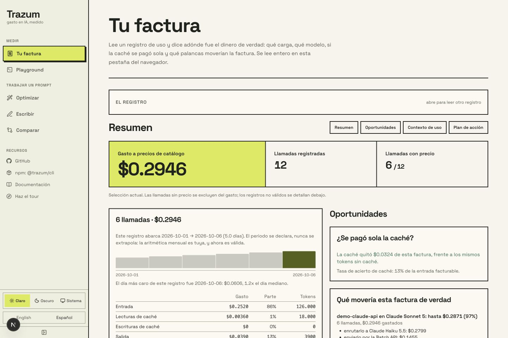

# Setup and integrations

[Documentation](README.md) / Setup

Install only the interface you need. For a first result, start with the
[quick start](quick-start.md). This page covers configuration and integration.

| Interface | Start here |
|---|---|
| Terminal | [CLI](#cli) and [project setup](#the-first-five-minutes-trazum-init) |
| Browser | [Web app](#web), [accounts](accounts.md), [Vercel](#deploying-to-vercel) |
| Application code | [Library](#library) |
| AI assistant | [MCP package](../packages/mcp/README.md) or [Claude Code plugin](../plugin/README.md) |
| Editor and CI | [VS Code](../apps/vscode/README.md) and [CI recipes](ci.md) |

## Getting started

```bash
npx @trazum/cli init
```

No API key is needed. Analysis runs locally; `npx` may download the package from npm. It reads what is already here — your prompts,
which provider your code calls, a usage log if one is lying around — writes a
config out of what it can actually justify, and prints the single most valuable
thing it found. See [the first five minutes](#the-first-five-minutes-trazum-init).

Or start from one file:

```bash
npx @trazum/cli optimize your-prompt.txt --cost
```

Either way, keep it around:

```bash
npm install -g @trazum/cli     # the terminal
npm install @trazum/core       # the library
npm install @trazum/mcp        # the MCP server, for an agent
npm install @trazum/tokenizer-openai  # optional: exact counts for OpenAI models
```

Or hand the whole thing to Claude Code as a plugin — the `trazum` skill plus
the MCP server, installed together, nothing else to configure:

```bash
claude plugin marketplace add Davmunrey/Trazum
claude plugin install trazum@trazum
```

The plugin's skill is [the same document](../plugin/skills/trazum/SKILL.md) this
repository's own agents work from, derived by
`scripts/build-plugin-skill.mjs` with only the invocation changed — a test
fails the build if the two drift apart in any other way.

<details>
<summary>From source, if you are working on Trazum itself</summary>

```bash
npm install
npm run build      # published packages and editor extension
npm test           # every workspace and the Action
npm run verify     # the above plus typecheck and the web build
```

</details>

<sub>The test count used to be written here as a number. It said 580 while the real
figure had reached 798, because nothing checked it — so it now says what the command
covers instead. A number nobody maintains is worse than no number.</sub>

### The first five minutes: `trazum init`

```bash
npx @trazum/cli init
```

```
What is here

  Running inside a terminal.
  1 prompt file found.
  Usage log found: usage.jsonl.

What the config would say
  + usage.model  100% of the measured bill went to claude-opus-5
  + usage.callsPerMonth  240 calls over 30 days, stated as 240 a month
  + usage.avgOutputTokens  96000 output tokens over 240 calls averages 400
  · usage.cacheHitRate  this log has no cache columns at all, which is not the same as a hit rate of zero
  · usage.batchEligible  whether the work can wait for a batch window is a product decision, and no log records it
  · labels  1 label in the log, and nothing here proves which prompt file sends which
  · spend.maxUsd  a budget is a policy, so it is yours to set — the measured figure is $38.40 over 30 days

The most valuable thing found
  240 calls labelled "classify" went to Claude Opus 5 over 30 days.
  They cost $38.40.
  The same work fits Claude Sonnet 5, which is cheaper per token.
  The Batch API halves both halves of the bill, for work that can wait.
  Together: $30.72 over the same 30 days.
```

It is a **detection, not a wizard**. Nothing is asked. Each line above is
something that was found — a prompt, a provider named in your code, a log —
or a key it declined **with what would settle it**. `--dry-run` prints the
config and writes nothing; `--yes` replaces one that is already there;
without it an existing config is left alone.

**Every key it writes carries the arithmetic that justified it.** A generated
config full of guessed thresholds is one nobody trusts and everybody deletes,
and it is worse than an empty one, because six weeks later it reads as a
decision somebody made.

Four things it refuses to write, and they are the interesting four:

- **A budget.** A log says what your traffic *was*; a budget says what it *may
  cost*, which no log can answer. "The measured month plus twenty per cent"
  would be this tool inventing a threshold and then grading you against it. So
  the measured figure is handed over and the limit stays yours.
- **A monthly rate from a short window.** Twenty-eight days minimum, so every
  weekday appears the same number of times. Four days multiplied by seven is a
  forecast wearing a measurement's clothes.
- **A cache hit rate from a log with no cache columns.** Not recorded is not
  not-happened. Writing `0` there would tell every later caching advisory that
  caching is doing nothing — a finding invented out of a missing field.
- **`batchEligible`, in either direction.** Whether the work tolerates a batch
  window is a product decision, and no log records it. `false` would quietly
  delete the batch lever from every report; `true` would sell a saving on
  latency nobody agreed to give up.

It also declines a model when your code names a *provider* and no model. `where`
prints a provider's default because a reader can see it is a guess; a config
file cannot.

No usage anywhere? It says so, and points at
[docs/usage-logs.md](../docs/usage-logs.md) — Anthropic, OpenAI, the Vercel AI SDK
and an OTel collector, with records you can copy.

`trazum init --json` is the same proposal as data, including every declined key
and its reason — [contracted in docs/json-output.md](../docs/json-output.md#the-first-run-document).
It writes nothing.

### CLI

```bash
node packages/cli/dist/index.js optimize prompt.txt --calls 50000 --diff
```

```
Input tokens
  190 → 137   -27.9% (estimated, ±6%)

Rules applied
  [safe] Repeated paragraphs (1×, ~19 tokens)
  [safe] Wordy phrasing (1×, ~3 tokens)
  [safe] Politeness formulas (4×, ~19 tokens)
  [safe] Filler and throat-clearing (2×, ~11 tokens)

Cost with Claude Opus 5
  50,000 calls/month · 300 output tokens per call
  $422.50 → $409.25   saving $13.25/month (3.1%)

Beyond shortening the prompt
  → This task may not need Claude Opus 5 ~$327.40/month
  → If the work tolerates latency, use the Batch API ~$204.62/month
```

Every other command, each with its own chapter in [the command
reference](../docs/commands.md):

```bash
trazum doctor                        # survey the whole workspace
trazum plan usage.jsonl              # the findings as a ranked plan
trazum verify plan.json --against new.jsonl   # did it work?
trazum history reports/              # the long run, from stored reports
trazum connect anthropic             # your bill, read from the provider
trazum store                         # what is kept, and what a prune takes
trazum watch --once                  # did anything cross, this afternoon
trazum serve                         # answer before the call is sent
trazum rollup a.json b.json          # several people's bills, one roll-up
trazum profile usage.jsonl --html-out report.html   # the report somebody forwards
trazum bill ~/.claude/projects --pdf-out bill.pdf   # the bill as a PDF attachment
trazum pulse --max-stale-hours 36    # did anything stop running?
trazum bench                         # how fast is Trazum on this machine
trazum rank prompts/                 # which one to fix first
trazum blame prompts/system.txt      # who made it expensive, and when
trazum diff old.txt new.txt          # what this edit cost
trazum check prompts/ --max-tokens 2000
trazum eval prompts/system.txt --cases cases.json
trazum where src/agent.ts            # which provider this actually calls
trazum models                        # pricing table and cache minimums
trazum rules                         # what each rule does, and its id
trazum --help
```

When redirected it writes only the optimised prompt, so it pipes cleanly:

```bash
cat prompt.md | node packages/cli/dist/index.js optimize - > prompt.optimised.md
```

To install it as a `trazum` command:

```bash
npm link -w @trazum/cli
```

**Token budgets in CI.** `trazum check` exits 1 when the prompt busts its
budget, so a template that grows unchecked breaks the build instead of the bill:

```bash
trazum check prompts/system.txt --max-tokens 2000
# FAILED 2,481 tokens busts the budget of 2,000.
#   Optimised with "trazum optimize --level safe" it would land at ~1,913 tokens and fit.
```

**Before it reaches CI: a pre-commit hook.**

```bash
ln -s ../../scripts/pre-commit .git/hooks/pre-commit
```

```
trazum: these prompts are over their token budget:
  prompts/system.txt

  trazum doctor .          shows how far over, and what it costs
  Shorten them, raise the budget in trazum.config.json, or commit with --no-verify.
```

**It blocks only on prompts your commit actually touches.** A hook that refuses a
commit over a *different* prompt somebody else committed last month is one people
learn to pass `--no-verify` to — and then it is worse than no hook at all.
`TRAZUM_HOOK=0` disables it; nothing staged, no Trazum installed, no prompts or an
unreadable config each say so once and exit 0. One real limitation: it reads the
working tree, not the staged blobs, so it judges a prompt's newest edit even when
an older version is what is staged.

In GitHub Actions, use the packaged action — nothing to install:

```yaml
- uses: actions/checkout@v7
- uses: Davmunrey/Trazum@e0420aef9fbe0a07bc5ecbaa64556e06d22541ca  # 2.5.1
  with:
    target: prompts/system.txt
    max-tokens: 2000
```

**One-click fixes, as suggestions.** `suggest-fixes: true` posts the optimised
prompt as a GitHub *suggested change*, which a reviewer applies with one button:

```yaml
permissions:
  contents: read
  pull-requests: write
with:
  target: prompts/
  suggest-fixes: true
  github-token: ${{ secrets.GITHUB_TOKEN }}
```

**A suggestion, not a commit, and that is deliberate.** Committing the fix would
need `contents: write`; a suggestion lands in the same place with the same one
click on the `pull-requests: write` the comment mode already uses, and you stay
the one who commits. Two limits, both real: it uses the **safe** level only — a
one-click apply is not the moment for a diff that wants reading — and a
suggestion can only anchor to lines in the pull request's diff, so a PR that
edits three lines of a forty-line prompt gets a notice explaining why there is
no suggestion rather than a partial rewrite.

**Pinned to a commit SHA, not a tag** — the same rule
[SECURITY.md](../SECURITY.md) states and `security.test.js` enforces on every
third-party action in this repository. A tag is a mutable pointer: whoever can
move `v1` can change what runs in your workflow with your token. The `# 1.0.0`
comment names the version at that commit, and is what Dependabot reads to offer
you the bump.

**The report lands in the run summary automatically** — every run, pass or fail,
with no token and no permissions. To also post it as a pull request comment that
replaces its own previous one:

```yaml
permissions:
  contents: read
  pull-requests: write     # the action cannot grant itself this

steps:
  - uses: actions/checkout@v7
  - uses: Davmunrey/Trazum@e0420aef9fbe0a07bc5ecbaa64556e06d22541ca  # 2.5.1
    with:
      target: prompts/            # a directory uses trazum.config.json budgets
      comment: true
      github-token: ${{ secrets.GITHUB_TOKEN }}
```

**Commenting can never fail your build.** No pull request, comments disabled, or
a read-only token — each prints a notice and carries on, because the report has
already reached the run summary. That matters on **pull requests from forks**,
where `GITHUB_TOKEN` is read-only by design and the comment simply will not post.

If you go looking for a way around that, the answer you will find is
`pull_request_target`. **Don't.** It runs with a writable token against the base
repository while checking out code the contributor controls, which turns "we
wanted to comment on a PR" into arbitrary code execution with your secrets. The
run summary is there precisely so you do not need it. Trazum asserts in CI that
it uses `pull_request_target` nowhere.

A passing report is collapsed; a failing one is not. A green table that stays
green on every push is the thing you learn to skip — and then you skip the red
one too.

**The spend gate, packaged.** The same action gates the bill itself when handed
a usage log instead of prompts — mutually exclusive with `target`, because one
run gates tokens before the money is spent or the spend itself, and saying
which is the caller's job:

```yaml
- uses: Davmunrey/Trazum@e0420aef9fbe0a07bc5ecbaa64556e06d22541ca  # 2.5.1
  with:
    usage-log: logs/yesterday.jsonl
    max-usd: '50'            # exit 1 over budget — no period assumed
    # against: logs/day-before.jsonl
    # max-growth-usd: '10'
    # label: chat            # one workload's budget
    # since: '2026-08-11'    # one period's — until includes its whole day
    # until: '2026-08-17'
```

The profile report lands in the run summary either way, and a failing gate
still writes it — a red build with no report is a mystery, and mysteries get
deleted from pipelines.

**The report leaves the terminal in five shapes.** `--markdown-out` for a CI
summary or a PR comment, `--csv-out` for whoever signs off the bill (one row
per workload and model, no total row, empty cells where dollars are unknown),
`--html-out` and `--pdf-out` for the person who reads attachments rather than
terminals (the PDF has no dependency and no embedded font, and `bill` writes
all four too), and `--json` for anything built on top — documented field by field in
[docs/json-output.md](../docs/json-output.md), with a `schemaVersion` and a test
that fails if the two ever disagree. Point `profile` at a **directory** and a
month of rotated logs is read in name order as one bill.

Or by hand, if you already have the repo checked out:

```yaml
- run: npm ci && npm run build
- run: node packages/cli/dist/index.js check prompts/system.txt --max-tokens 2000
```

### The rest of the commands, in their own book

`optimize`, `check` and `init` above are the front door. Every other
command has its own chapter — same prose, same worked examples, one page —
in **[the command reference](../docs/commands.md)**: the
measured multiplication (`--from-log`), the cache reorder, the CI baseline,
the fleet, the plan and its verification, the provider pull, the gateway,
the evaluations that spend money and say so first, and everything else the
[table above](../README.md#the-52-commands) links to.

`trazum --version` prints the version on its own, and works when your config is
broken — which is exactly when somebody is asking.

### Web

<div align="center">
  
</div>

*Synthetic demonstration data. This screenshot is not a customer bill.*

```bash
npm run build:web
npm run dev:web        # http://localhost:3000
```

An interface for pasting a prompt, tuning the usage scenario, and reading the
word-by-word diff, the saving and the advisories. Prompt optimization requests
reach the configured web server; optional LLM passes also call its configured
provider. Optimization history is stored in the browser. Usage-log Bill analysis
and the Playground's deterministic commands run locally in the tab.

**Reordering for the cache is available here too**, behind a checkbox rather than
a level, with the same warning the CLI prints and the same refusals reported. It
is the largest saving Trazum can make, and it should not need a terminal to find.

**And there is a Compare tab.** Two versions of a prompt, and what the edit did:
the token delta, what it costs per month, and which advisories and rules it
introduced or resolved. Every figure is `after - before`, so **positive means
worse** — the opposite of the rest of Trazum — and the page says so above the
numbers rather than beside them, because a reader arriving from Optimise has the
opposite convention already loaded.

`Compare what the rules would leave` is off by default and the default is the
interesting half: your edit changed the text as written, so the text as written is
what you are being asked about. Trimming both sides first hides a prompt that
doubled in length and happened to double in courtesy.

The usage scenario is shared between the two tabs. Setting 50,000 calls on one and
reading 10,000 on the other would make their answers incomparable while looking
like they were about the same workload.

**So are phrase-level rewrites.** Two switches: one asks the model for
suggestions, the second takes them. They are listed above the saving, one line
each — `You should always make sure to → Always  ~4 ×2` — with a count of how
many the checks threw out, because "four did not survive" is the useful fact and
which four is noise unless you are debugging the model. Nothing is applied unless
the second switch is on, and turning the first one off clears it.

**And a "Your bill" tab**, which is [`trazum profile`](commands.md#where-the-money-actually-went-trazum-profile)
in the browser: drop or paste a usage log and read where the money went — the
spend split, whether caching paid for itself, the levers that would actually
move the bill, conversation growth, and the answers that were cut off
mid-generation. The log is parsed entirely in the page against the bundled
pricing catalogue. **Nothing is uploaded**: there is no fetch in that
component, a test fails if one appears, and the only analytics event carries
two booleans. A usage log names your workloads, spend and conversation counts —
exactly the file nobody should have to hand to a server to see a report on it.

The drop zone reads more than logs. A **Claude Code project folder** —
`~/.claude/projects` as it sits on disk — prices every transcript in the page,
labelled by project, with the counts crossing and never the words. An
**OpenTelemetry export** prices its GenAI spans the same way. And a **price
card** — an OpenRouter `/models` response, or the same overlay JSON a
`--pricing` file holds — widens the catalogue every figure in the tab prices
with, so a model the bundled snapshot has never met (your Qwen, your
self-hosted rate from [`trazum ownrate`](../docs/commands.md#the-model-you-run-yourself-trazum-ownrate))
gets the same exact arithmetic, still without a single request leaving the page.

**Under the report, the rest of the loop.** The ranked plan — each action with
its money as a projection *or* a measured stake and never both, the typed
assumption it rests on, and the command that would check that assumption — and
below it, *Did it work?*. **Save plan.json** writes byte-for-byte what
`trazum plan -o` writes, so a plan made in a tab can be committed, gated on in
CI, and opened back here later. Opening a saved plan turns the log in the tab
into the check on it: three outcomes, never two, with the three cannot-tell
reasons kept distinct. Saved as a file rather than offered as a link, because a
link would mean this page storing somebody's bill somewhere — an access-control
question nobody has designed. [The plan format is documented](../docs/plan-format.md).

**A guided tour walks the public tabs** — Optimise, Write, Compare, Bill and
the Playground — ringing each panel in place with a sentence on what it
answers. It never auto-plays: a first visit is offered it once, and the compass
in the rail starts it any time after. The **Playground** tab is the CLI itself
in the page — 13 commands that spend nothing and touch no network, over
sample files already loaded, through the same `@trazum/core` functions the
terminal runs, so `trazum profile usage.jsonl` can be tried before anything is
installed, against data that never existed outside the browser.

The HTTP API behind it is public and small:

```bash
# Metadata: models, and whether an LLM is configured on the server
curl https://your-deployment/api/optimize

# Optimise
curl -X POST https://your-deployment/api/optimize \
  -H 'content-type: application/json' \
  -d '{
    "prompt": "Please, in order to help me, analyse {{x}}. Thanks!",
    "level": "safe",
    "locale": "en",
    "reorder": false,
    "suggest": false,
    "applySuggestions": false,
    "usage": { "model": "claude-opus-5", "callsPerMonth": 20000, "avgOutputTokens": 300 }
  }'
```

`reorder`, `suggest` and `applySuggestions` are honoured only on a literal `true`
— the body is untrusted, and a truthy check would let `"false"` rearrange
somebody's prompt. With `reorder`, the response carries what moved and what was
declined, and `original` stays the text you sent so a diff shows the move. With
`suggest`, it carries every proposal that survived the checks and everything
rejected and why — present even when the model proposed nothing, so "nothing was
found" is distinguishable from "you did not ask". `applySuggestions` without
`suggest` is a **`400`**, not a no-op, refused before any call to the model.

```bash
# Compare two versions: what did this edit cost?
curl -X POST https://your-deployment/api/compare \
  -H 'content-type: application/json' \
  -d '{
    "before": "Classify {{x}}. Answer with the category only.",
    "after": "Please kindly classify {{x}}. Thank you!",
    "optimizeBoth": false,
    "usage": { "model": "claude-opus-5", "callsPerMonth": 50000 }
  }'
```

`POST /api/compare` returns every figure as `after - before`, so **positive
means worse**. Both endpoints are rate limited (30/min per IP), with a bucket
each. And `/api/optimize` will not fetch an LLM endpoint a caller names: a
request may only **select** one from `TRAZUM_ALLOWED_LLM_ENDPOINTS`, empty by
default — stricter than filtering the URL, because a hostname an attacker
registered can resolve wherever they like. See [SECURITY.md](../SECURITY.md).

### Signing in (optional)

Off by default, and a deployment that leaves it off is the tool this README has
been describing all along: paste a prompt, get an answer, nothing remembered.

Set three variables and the sidebar grows a **Sign in** button at its foot:

```sh
TRAZUM_GITHUB_CLIENT_ID=Iv1.xxxx
TRAZUM_GITHUB_CLIENT_SECRET=xxxx
TRAZUM_PUBLIC_URL=https://trazum.example
```

A fourth, `TRAZUM_DATABASE_URL`, points it at any Postgres so sign-in survives a
restart; without it sessions live in memory and the account menu says
"temporary session". Trazum asks GitHub for `read:user` and nothing else, **never stores
the access token**, and stores session cookies only as their SHA-256.
Misconfigure any of it and sign-in simply stays off, with `/api/auth/*`
answering 503 naming the variable to set.

Signed in, a **Library** tab appears: prompts you saved and every version of
each, append-only, token counts recomputed on read rather than stored. On the
Compare tab, **Create share link** publishes a comparison at `/c/<token>` for
anyone holding the URL — expiring after thirty days by default, revocable, kept
out of search engines, and saying what it publishes *before* the button. Every
share link doubles as a **README badge** at `/badge/<token>.svg`, recomputed on
every load, with no script and no prompt text. Set `TRAZUM_ADMINS` and `/admin`
totals what every prompt on the deployment adds up to — names and token counts,
never anybody's prompt text, and deliberately not a spend report.

[docs/accounts.md](../docs/accounts.md) has the setup, the schema, every security
decision and why, the limits, and an explicit list of what is **not** covered.

### Deploying to Vercel

The repo is an npm workspaces monorepo; Vercel handles it with no special
configuration:

1. Import the repository in Vercel.
2. **Root Directory**: `apps/web`. The rest — installing from the workspace
   root, building `@trazum/core` via `prebuild` — is automatic.
3. Optional variables: `TRAZUM_LLM_*` to offer the LLM pass without users
   supplying keys, `NEXT_PUBLIC_POSTHOG_KEY` for analytics, `TRAZUM_GITHUB_*`
   and `TRAZUM_PUBLIC_URL` for sign-in.

Vercel runs more than one instance, so if you enable sign-in there, set
`TRAZUM_DATABASE_URL` as well. Without it each instance keeps its own sessions
in memory and a browser is signed in against one and signed out against the
next.

### Library

```ts
import { optimize, refineWithLlm, openAiCompatible } from '@trazum/core';

const result = optimize(prompt, {
  level: 'safe',
  locale: 'en',
  usage: {
    model: 'claude-opus-5',
    callsPerMonth: 50_000,
    avgOutputTokens: 500,
    cacheHitRate: 0.9,
    batchEligible: false,
  },
});

console.log(result.optimized);
console.log(result.savings.monthlySavingsUsd);
```

`reorderForCache` is the API behind `--reorder`. It returns the original text
unchanged when nothing can safely move, and always reports what it declined and
why — a saving Trazum chose not to take is one the caller cannot evaluate:

```ts
import { reorderForCache } from '@trazum/core';

const r = reorderForCache(prompt, { minPrefixTokens: 1024 });  // the model's minimum

r.text;                 // the rearrangement, or `prompt` byte-for-byte
r.tokensMoved;          // moved out of paid-every-call into the prefix
r.prefixTokensBefore;   // 14
r.prefixTokensAfter;    // 1174
r.declined;             // [{ reason: 'backward-reference', phrase: 'above', text }]
```

`minPrefixTokens` is a bar on the **resulting prefix**, not on the amount moved.
A prefix below the model's minimum caches nothing at all, so a rearrangement that
does not clear it buys nothing — but a head that already clears it gains from any
block that joins it, however small.

`comparePrompts` is the API behind `trazum diff`. Note the sign: everything it
returns is `after - before`, so **positive means worse** — the opposite of
`result.savings`, and the reason it lives in its own module.

```ts
import { comparePrompts, formatSignedUsd } from '@trazum/core';

const change = comparePrompts(oldPrompt, newPrompt, { usage });

change.tokenDelta;                      //  +37   (grew)
formatSignedUsd(change.monthlyDeltaUsd) //  "+$9.25"
change.advisories.appeared;             //  ['contradictory-instructions']
change.rules.noLongerFiring;            //  what the edit cleaned up
```

**Two entry points.** `@trazum/core` is browser-safe and imports no Node
builtins — that is enforced by a test that walks the import graph, not by
convention, because the web app bundles it and one `node:fs` import anywhere in
that graph fails the build. Anything that reads the filesystem lives on
`@trazum/core/node`:

```ts
import { loadConfig, walkPrompts } from '@trazum/core/node';

const { config, path } = await loadConfig();   // null path = none found
const { files, truncated } = await walkPrompts('prompts/');
```

`parseConfig` and `budgetFor` are pure functions of their arguments, so they sit
on both.

---
